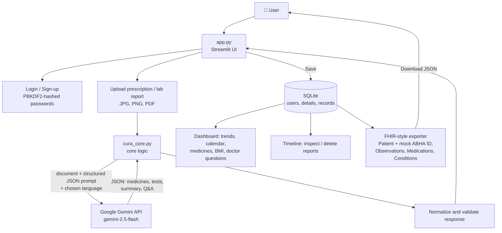

# 🩺 Cura AI - Personal Health Copilot

> Turn confusing prescriptions and lab reports into clear, multilingual, easy-to-follow health information.

🔗 **Live Demo:** `PASTE-YOUR-STREAMLIT-LINK-HERE`

Upload a prescription or lab report (photo/PDF). Cura AI extracts medicines, dosages, test values and
dates, explains them in simple language (**English, Hindi, Telugu, Tamil, Kannada**), saves them to a personal
health timeline, tracks your results over time, and exports **FHIR-style records** tagged with a
**mock ABHA ID** to show how the app fits into India's digital health ecosystem.

---

## 🎯 The Problem

Many patients, especially in regional-language communities, struggle to understand handwritten prescriptions
and technical lab reports. Medical history is scattered across paper and photos, and it is hard to see how
test results change over time.

## 💡 Our Solution

Cura AI is a personal health copilot that:

- 📄 **Reads** prescriptions and lab reports from photos or PDFs, printed or handwritten
- 🧠 **Extracts** medicines, dosages, test values, reference ranges and dates using Google Gemini
- 🗣️ **Explains** results in plain language in 5 languages (English, Hindi, Telugu, Tamil, Kannada), with answers to common questions
- 📅 **Saves** everything to a personal timeline and health calendar
- 📊 **Tracks** lab values over time with trend charts, plus a BMI screening note
- 💬 **Suggests** questions to ask your doctor at the next visit
- 🔗 **Exports** FHIR-style records with a mock ABHA ID, aligned with India's digital health ecosystem (Patient, Observations, Medications, Conditions, DiagnosticReport as downloadable JSON)

---

## 🧑‍⚖️ Quick Guide for Judges

No API key or setup is needed. Just open the live link.

1. **Log in with the test account:** username `demo`, password `demo1234` (or create your own account on the *Create account* tab; the ABHA ID is a demo value and can be left blank).
2. Pick a **language** in the sidebar (English / Hindi / Telugu / Tamil / Kannada).
3. Go to **📄 Upload report**, upload a sample prescription or lab report (JPG, PNG or PDF), and click **Analyze document**.
4. Review the summary, medicines, test results, flagged findings and plain-language Q&A.
5. Click **Save to my health timeline**.
6. Visit **🏠 Dashboard** to see trends, the health calendar, latest medicines and questions for your doctor.
7. Visit **🕒 Timeline** to reopen or delete saved reports, and click **Export FHIR (JSON)** on a report (or **Export all records**) to download the FHIR-style record with the mock ABHA ID.
8. Visit **👤 My details** to add age, height and weight for the BMI note.

> 🔒 Please use synthetic or sample documents only. Do not upload real personal medical records.

---

## 🏗️ Architecture



### Project structure

| File | Responsibility |
|------|----------------|
| `app.py` | Streamlit user interface: theme and CSS, login/sign-up, sidebar navigation, Dashboard, Upload, Timeline and My Details pages |
| `cura_core.py` | Core logic: multilingual UI strings (5 languages), Gemini prompt, SQLite database layer, password hashing, Gemini analysis call, FHIR-style exporter, BMI and report-display helpers |
| `requirements.txt` | Python dependencies |
| `.streamlit/secrets.toml.example` | Template for the server-side API key |

### How the data flows

| Stage | What happens |
|-------|--------------|
| **1. Authentication** | Users sign up or log in. Passwords are salted and hashed with PBKDF2-SHA256 (200,000 iterations) and compared in constant time. |
| **2. Upload** | The user uploads a prescription or lab report as an image or PDF. |
| **3. AI extraction** | The file and a strict JSON-schema prompt are sent to Gemini at low temperature. The prompt forbids guessing, diagnosing or recommending treatment. |
| **4. Normalization** | The JSON response is parsed and missing fields are filled in, so the UI never breaks on incomplete output. |
| **5. Explanation** | The summary, abnormal-value meanings, doctor questions and answers are written in the user's chosen language. |
| **6. Storage** | Saved reports go into SQLite, linked to the user's account. |
| **7. Insights** | The dashboard reads saved records to draw lab trend charts, a health calendar, the latest medicines and a BMI screening note. |
| **8. FHIR export** | Saved (or freshly analyzed) reports are converted into a FHIR-style Bundle: a `Patient` carrying the mock ABHA ID, `Observation` per lab value (with H/L/N interpretation), `MedicationRequest`, `Condition` and a `DiagnosticReport`. The user downloads it as JSON. |

### Tech stack

| Layer | Technology |
|-------|-----------|
| App framework / UI | Streamlit with custom CSS |
| AI (document reading + explanation) | Google Gemini via `google-genai` |
| Database | SQLite |
| Interoperability | FHIR-style JSON export (HL7 FHIR R4 structure, demo) |
| Data handling | pandas |
| Language | Python |
| Security | PBKDF2 password hashing, server-side API key, no key exposed to users |

### Safety design

- Cura AI **does not diagnose, prescribe or recommend treatment**. The disclaimer appears on every page.
- The AI is told to use only visible information and to leave unreadable fields empty instead of guessing.
- The ABHA ID is a mock value for demonstration only.

---

## 👥 Team & Contributions

| Member | Role | Contribution |
|--------|------|--------------|
| **Syed Rehan Pasha** | Team Lead | Developed the core code and overall application |
| **Sumeet Awantgi** | UI/UX & Error Correction | Designed the user interface and experience, and fixed errors across the app |
| **Shriraksha Deshpande** | Debugging | Debugged and stabilized the application |
| **Rishika** | Feature Development | Helped add new features |
| **Girija** | Feature Development | Helped add new features |

---

## 🚀 Run Locally

1. Install dependencies:
   ```bash
   pip install -r requirements.txt
   ```
2. Add your Gemini API key (the app never asks users for it):
   ```bash
   cp .streamlit/secrets.toml.example .streamlit/secrets.toml
   # then edit .streamlit/secrets.toml and set GEMINI_API_KEY
   ```
   Alternatively, set the `GEMINI_API_KEY` environment variable.
3. Start the application:
   ```bash
   python -m streamlit run app.py
   ```
4. Open `http://localhost:8501` in your browser.

## ☁️ Deployment

Deployed on **Streamlit Community Cloud**. The Gemini API key is stored in the app's private **Secrets**
settings, so visitors can use every feature without entering a key.

---

## ⚠️ Disclaimer

Cura AI is a prototype built for demonstration. It explains documents in simple language and does not
provide medical advice, diagnosis or treatment. Always consult a qualified doctor for medical decisions.

---

<p align="center">Built with ❤️ by Team Cura AI</p>
