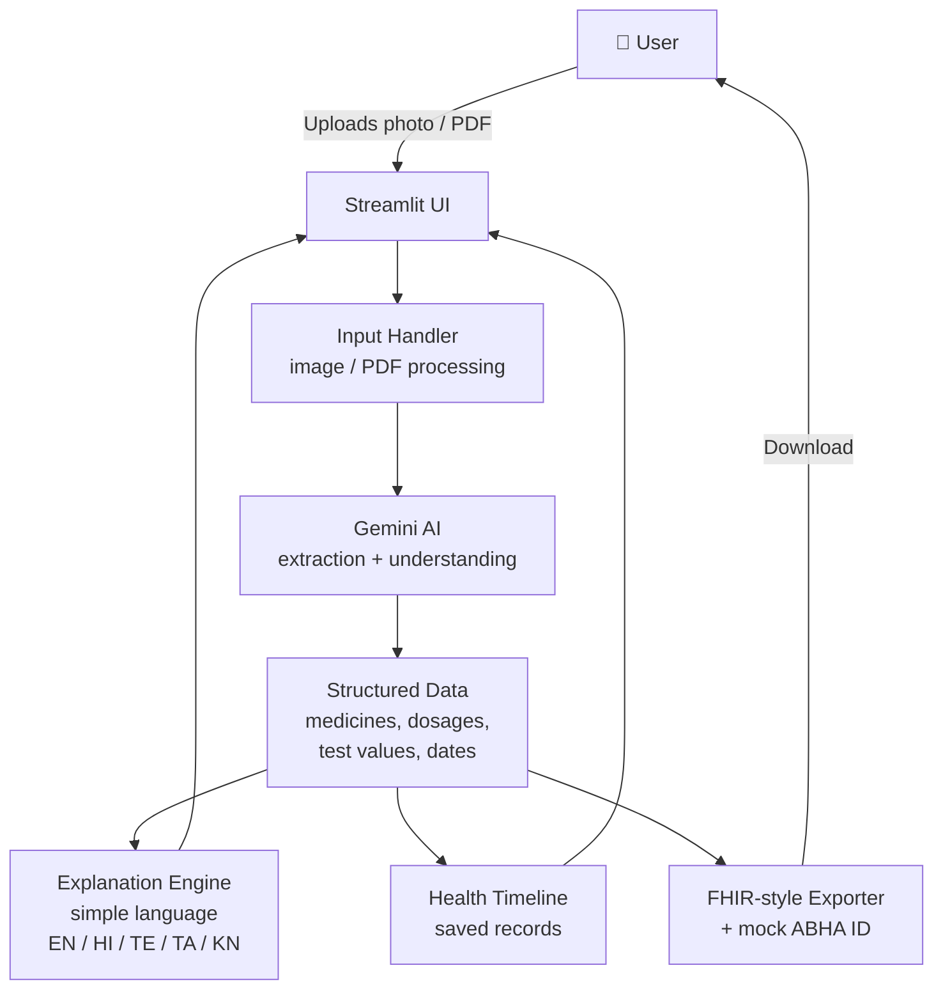

# 🩺 Cura AI - Personal Health Copilot

> Turn confusing prescriptions and lab reports into clear, multilingual, actionable health information, in seconds.

Upload a prescription or lab report (photo/PDF). Cura AI extracts medicines, dosages, test values and
dates, explains them in simple language (**English, Hindi, Telugu, Tamil, Kannada**), saves them to a
timeline, and exports **FHIR-style records** with a **mock ABHA ID**.

---

## 🎯 The Problem

Many patients, especially in regional-language communities, struggle to understand handwritten prescriptions
and technical lab reports. Medical history is scattered across paper and photos, and is hard to share with
doctors or digital health systems.

## 💡 Our Solution

Cura AI acts as a personal health copilot that:

- 📄 **Reads** prescriptions and lab reports from photos or PDFs
- 🧠 **Extracts** medicines, dosages, test values and dates using Gemini AI
- 🗣️ **Explains** everything in simple language in 5 languages
- 📅 **Stores** results in a personal health timeline
- 🔗 **Exports** FHIR-style records with a mock ABHA ID, aligned with India's digital health ecosystem

---

## 🧑‍⚖️ Quick Guide for Judges

1. Open the app (see *Run Locally* below).
2. Enter the Gemini API key in the sidebar (or via `secrets.toml`).
3. Choose a language from the sidebar.
4. Upload a sample prescription or lab report (image or PDF).
5. Review the extracted medicines, dosages, values and dates, and the plain-language explanation.
6. Open the **Timeline** to see saved records.
7. Use **Export** to download the FHIR-style record with the mock ABHA ID.

---

## 🏗️ Architecture



### How the data flows

| Stage | What happens |
|-------|--------------|
| **1. Input** | The user uploads a prescription or lab report as an image or PDF through the Streamlit interface. |
| **2. AI Extraction** | The file is sent to the Gemini API, which reads the document and returns structured data (medicines, dosages, test values, dates). |
| **3. Explanation** | The structured data is explained in simple language in the user's chosen language. |
| **4. Timeline** | Extracted records are saved so the user can see their health history in chronological order. |
| **5. Export** | Records are converted into FHIR-style JSON and tagged with a mock ABHA ID for interoperability demonstration. |

### Tech Stack

| Layer | Technology |
|-------|-----------|
| Frontend / App framework | Streamlit |
| AI / OCR + understanding | Google Gemini API |
| Language | Python |
| Health data standard | FHIR-style JSON |
| Identity (demo) | Mock ABHA ID |

---

## 👥 Team & Contributions

| Member | Role | Contribution |
|--------|------|--------------|
| **Syed Rehan Pasha** | Team Lead | Developed the core code and overall application |
| **Sumeet Awantgi** | UI/UX & Error Correction | Designed the user interface and experience, and fixed errors across the app |
| **Shriraksha Deshpande** | Debugging | Debugged and stabilized the application |
| **Rishika** | Feature Development | Helped add new features |
| **Girija** | Feature Development | Helped add new features |

---

## 🚀 Run Locally

1. Install dependencies:
   ```bash
   pip install -r requirements.txt
   ```
2. Start the application:
   ```bash
   streamlit run app.py
   ```
3. Open `http://localhost:8501` in your browser.

## ⚙️ Configuration

Add your Gemini API key inside `.streamlit/secrets.toml` or directly into the sidebar at runtime.

```toml
# .streamlit/secrets.toml
GEMINI_API_KEY = "your-api-key-here"
```

---

## ⚠️ Disclaimer

Cura AI is a prototype built for demonstration. It does not provide medical advice, diagnosis or treatment.
The ABHA ID is a mock identifier. Always consult a qualified doctor for medical decisions.

---

<p align="center">Built with ❤️ by Team Cura AI</p>
